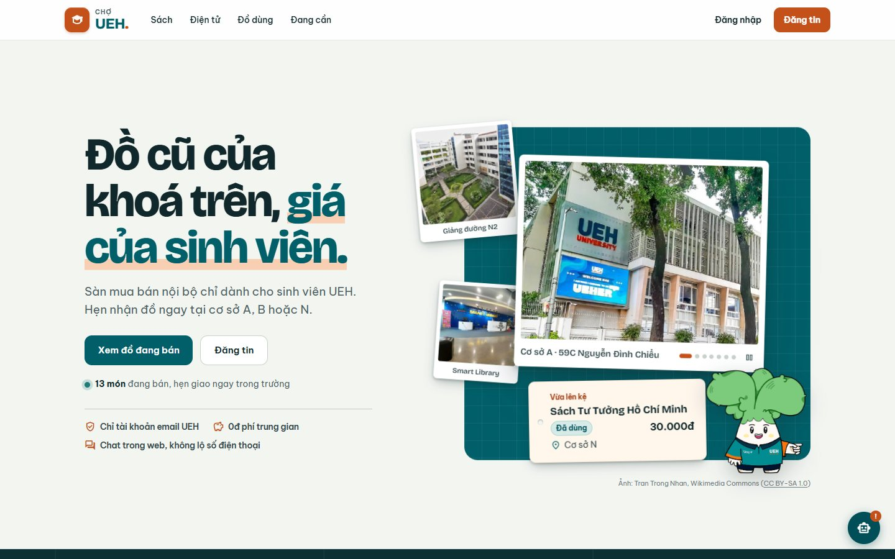
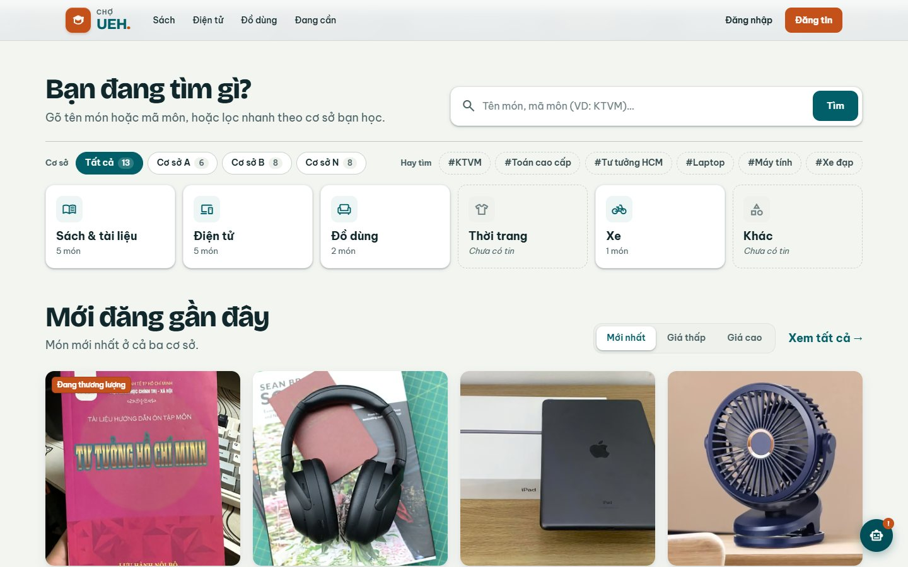
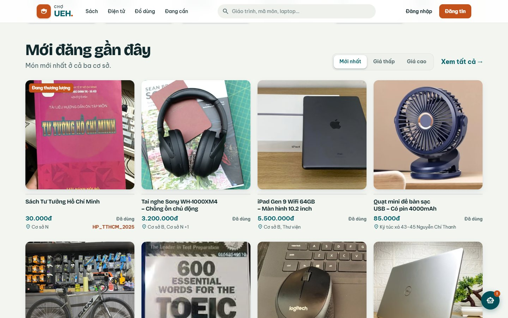
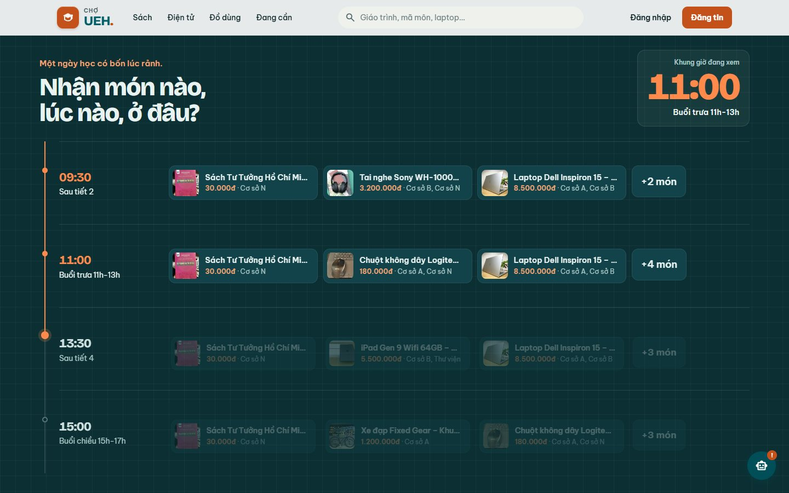
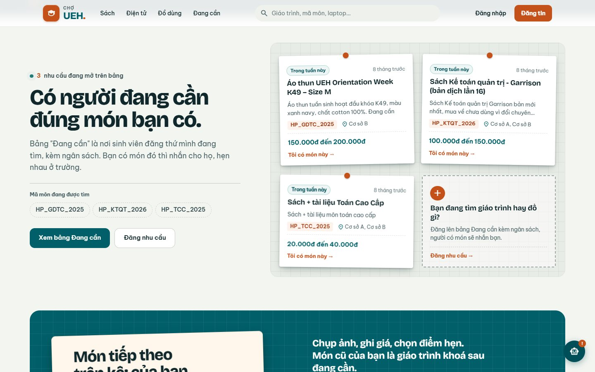
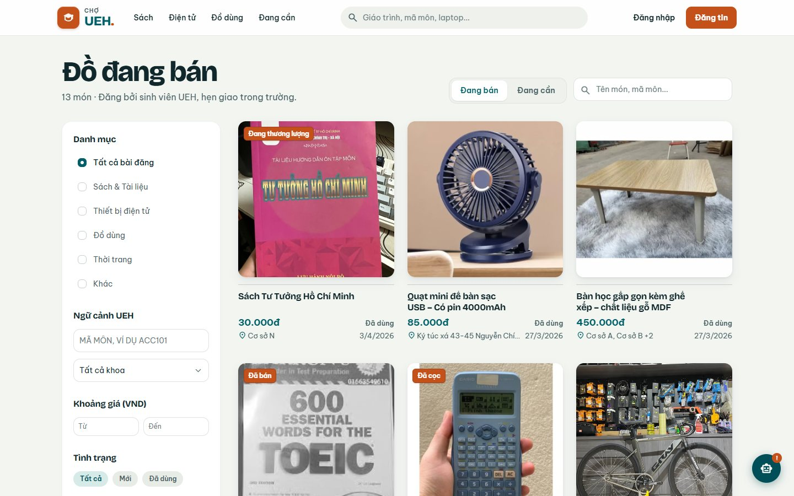
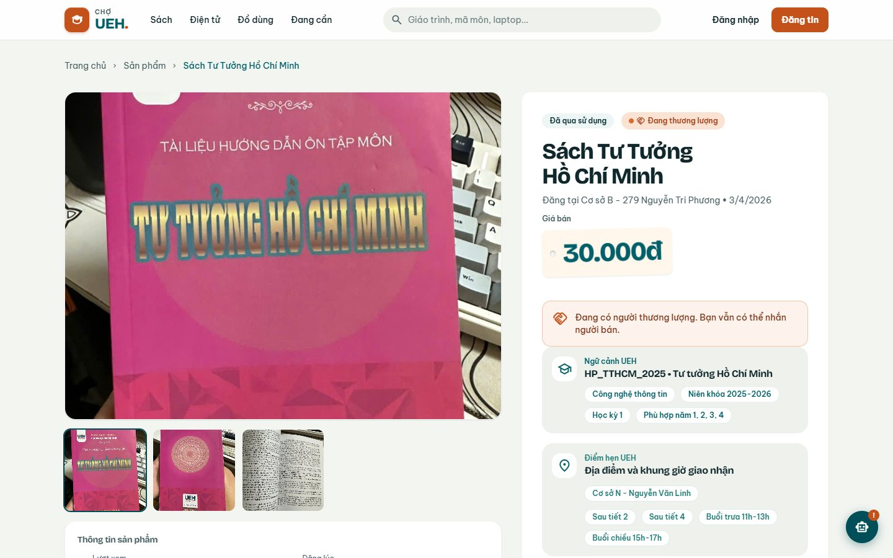
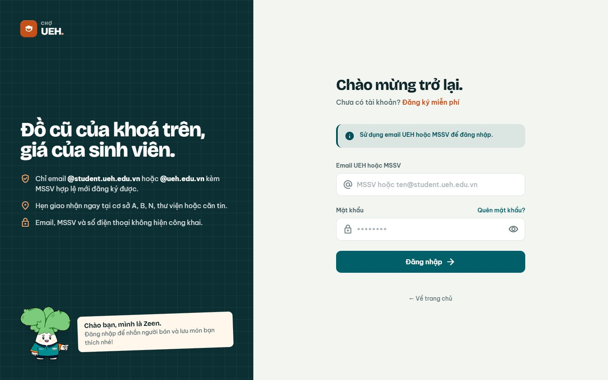
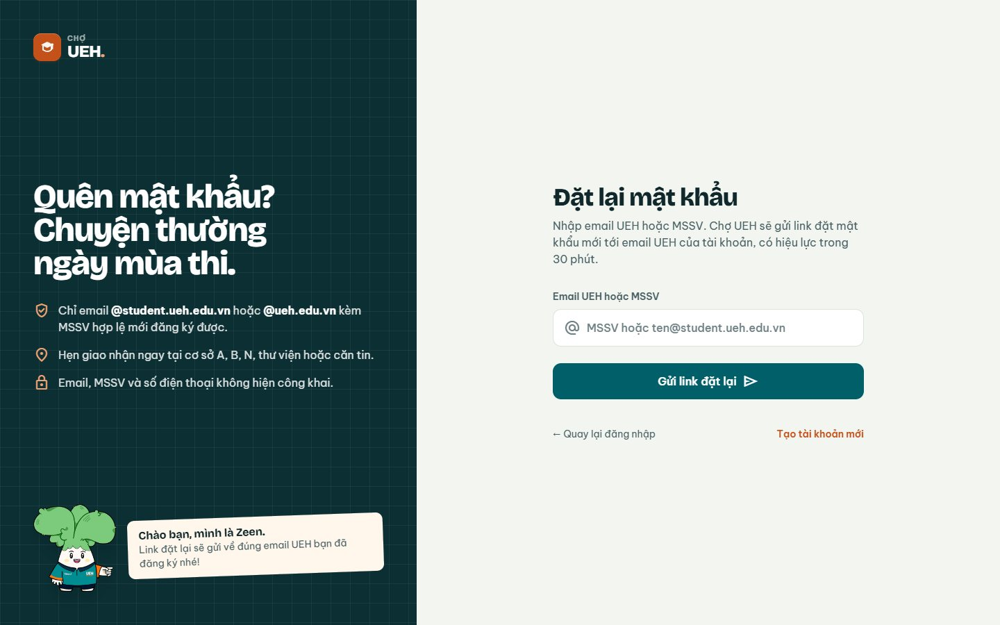
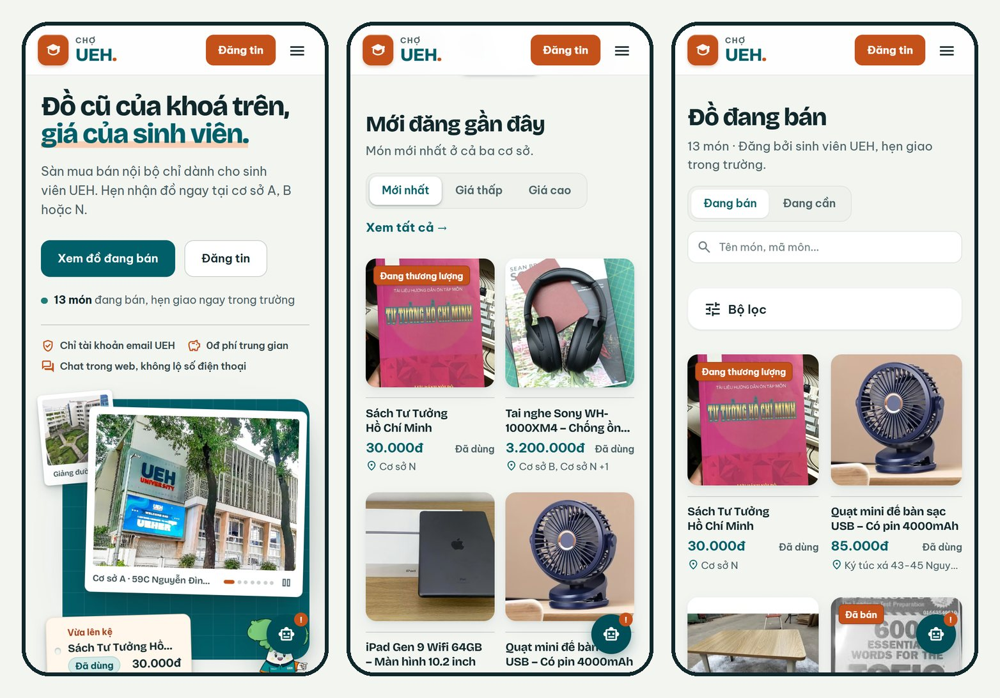

<div align="center">


# 🛒 Chợ UEH

### Đồ cũ của khoá trên, giá của sinh viên.

Sàn mua bán đồ cũ nội bộ dành riêng cho sinh viên Đại học Kinh tế TP.HCM (UEH).<br/>
Hẹn nhận đồ ngay tại cơ sở A, B, N, thư viện hoặc căn tin.

**🌐 Live demo:** [choueh-tmdt.onrender.com](https://choueh-tmdt.onrender.com)



</div>

---

## 📖 Giới thiệu

**Chợ UEH** là marketplace C2C mua bán đồ cũ chỉ dành cho cộng đồng UEH, phát triển trong học phần **Thương mại điện tử** năm học 2025–2026. Khác với Chợ Tốt hay Facebook Marketplace, Chợ UEH:

- chỉ nhận tài khoản đăng ký bằng email **`@student.ueh.edu.vn`** (sinh viên) hoặc **`@ueh.edu.vn`** (cán bộ) kèm MSSV hợp lệ;
- gắn **mã môn, khoa, học kỳ** vào từng tin đăng, nên tìm giáo trình theo môn rất nhanh;
- giao dịch **gặp mặt trong trường** theo điểm hẹn và khung giờ giữa các tiết học, không phí trung gian;
- có **bảng "Đang cần"** để sinh viên đăng thứ mình đang tìm, và trợ lý AI **Zeen** hỗ trợ tìm món.

> ⚠️ Chợ UEH là đồ án học thuật do sinh viên phát triển độc lập, **không phải sản phẩm chính thức** của Đại học Kinh tế TP.HCM.

---

## 🖼️ Ảnh chụp màn hình

<table>
  <tr>
    <td width="50%"><br/><sub><b>Tìm nhanh</b>: một ô tìm kiếm, lọc theo cơ sở, từ khoá hay tìm, danh mục</sub></td>
    <td width="50%"><br/><sub><b>Mới đăng gần đây</b>: lọc theo cơ sở và sắp xếp giá ngay trên trang chủ</sub></td>
  </tr>
  <tr>
    <td><br/><sub><b>Nhận món nào, lúc nào, ở đâu?</b>: cuộn để kim chạy qua bốn khung giờ rảnh trong ngày học</sub></td>
    <td><br/><sub><b>Bảng "Đang cần"</b>: nhu cầu thật, mã môn đang được tìm, ngân sách</sub></td>
  </tr>
  <tr>
    <td><br/><sub><b>Đồ đang bán</b>: bộ lọc theo danh mục, khoa, mã môn, giá, tình trạng</sub></td>
    <td><br/><sub><b>Chi tiết món</b>: nhãn giá, điểm hẹn, lưu tin, báo cáo vi phạm, nhắn người bán</sub></td>
  </tr>
  <tr>
    <td><br/><sub><b>Đăng nhập</b> bằng email UEH hoặc MSSV</sub></td>
    <td><br/><sub><b>Quên mật khẩu</b>: gửi link đặt lại qua email UEH</sub></td>
  </tr>
  <tr>
    <td colspan="2"><br/><sub><b>Trên điện thoại</b>: trang chủ, lưới món mới, danh sách sản phẩm</sub></td>
  </tr>
</table>

---

## 🏆 Chợ UEH so với nền tảng thông thường

| Tính năng | Chợ UEH | Chợ Tốt | Facebook Marketplace |
|---|:---:|:---:|:---:|
| Chỉ tài khoản email UEH | ✅ | ❌ | ❌ |
| Gắn mã môn / khoa / học kỳ vào tin | ✅ | ❌ | ❌ |
| Điểm hẹn trong trường + khung giờ theo tiết | ✅ | ❌ | ❌ |
| Bảng "Đang cần" | ✅ | ❌ | ❌ |
| UEH Green Score | ✅ | ❌ | ❌ |
| Trợ lý AI nội bộ (Zeen) | ✅ | ❌ | ❌ |
| Đánh giá người bán | ✅ | ✅ | ❌ |
| Phí trung gian | 0đ | Có gói trả phí | 0đ |

---

## ✨ Tính năng

### Mua bán
- 📦 **Hai loại tin**: bán đồ (`sell`) và bảng "Đang cần" (`wanted`) có ngân sách và mức độ cần gấp. Tối đa 6 ảnh mỗi tin, lưu trên Cloudinary.
- 🔍 **Tìm kiếm và lọc**: theo tên, mã môn, danh mục, khoa, giá, tình trạng; sắp xếp mới nhất / giá thấp / giá cao.
- 💬 **Chat 1-1** giữa người mua và người bán theo từng món, có số tin chưa đọc trên navbar.
- 🤝 **Trạng thái giao dịch**: đang thương lượng, đã cọc, đã bán. Người bán chọn người mua trong số những người đã nhắn tin; món đã bán tự rời khỏi danh sách công khai.
- ⭐ **Đánh giá người bán** (1–5 sao + bình luận), chặn tự đánh giá và đánh giá trùng.
- ❤️ **Lưu tin** để xem lại trong Dashboard.
- 🖼️ **Xem ảnh**: bấm ảnh thu nhỏ để đổi ảnh chính, bấm ảnh chính để phóng to toàn màn hình; chuyển ảnh bằng nút hoặc phím mũi tên, đóng bằng Esc.
- 🚩 **Báo cáo vi phạm** (spam, lừa đảo, trùng lặp, không phù hợp); admin xử lý trong trang quản trị.

### Riêng cho UEH
- 📚 **Ngữ cảnh học tập**: mã môn, tên môn, khoa, niên khoá, học kỳ, năm học phù hợp.
- 📍 **Điểm hẹn**: Cơ sở A, B, N, Thư viện, Căn tin, Sảnh chính và 4 khung giờ (sau tiết 2, buổi trưa, sau tiết 4, buổi chiều).
- 🌱 **UEH Green Score**: số món được dùng lại, tiền tiết kiệm, CO₂ giảm được, cấp độ.
- 🤖 **Zeen AI**: chatbot tìm món và hướng dẫn sử dụng (Groq, `llama-3.1-8b-instant`).

### Trang chủ
- Hero có slideshow 7 ảnh khuôn viên UEH trong khung Polaroid: tự chuyển sau 5 giây, chọn bằng chấm, tạm dừng được, vuốt trên điện thoại, và tự dừng khi rê chuột vào. Dòng ghi nguồn đổi theo từng ảnh.
- Hiệu ứng mở đầu: chữ trượt lên, ảnh rơi xuống, thẻ giá đung đưa, Zeen nhảy lên. Trên máy tính, các lớp ảnh nghiêng theo con trỏ chuột.
- Dải bảng giá chạy với các tin thật, thanh lọc nhanh theo cơ sở, lưới "Mới đăng gần đây", ba bước mua bán.
- Thời khoá biểu hẹn giao nhận điều khiển bằng cuộn trang.
- Bảng "Đang cần" và khối kêu gọi đăng tin.
- Tôn trọng `prefers-reduced-motion`: tắt mọi hiệu ứng khi máy bật giảm chuyển động.

### Tài khoản và bảo mật
- 🔐 Đăng ký / đăng nhập bằng email UEH hoặc MSSV, JWT trong cookie `httpOnly` + `sameSite=strict`.
- 🔑 **Quên mật khẩu**: link đặt lại một lần, hết hạn sau 30 phút. Chỉ lưu mã băm SHA-256 của token. Không tiết lộ email có tồn tại hay không. Đổi mật khẩu xong thì mọi phiên đăng nhập cũ bị đăng xuất.
- 🛡️ Ẩn email / MSSV / số điện thoại khỏi API công khai, escape regex trong tìm kiếm, Helmet, CORS, giới hạn tần suất cho đăng nhập, đăng ký, đặt lại mật khẩu và API.
- 🛠️ **Admin**: thống kê, quản lý người dùng, tin đăng, ảnh và báo cáo vi phạm.

---

## 🏗️ Kiến trúc

```
┌────────────────────────────────────────────────────────────────┐
│                        CLIENT (trình duyệt)                     │
│  EJS + Tailwind CDN + Material Symbols · 9 file JS phía client   │
│  scrollcraft (engine cuộn cho trang chủ)                         │
└───────────────────────────────┬────────────────────────────────┘
                                │ HTTPS
┌───────────────────────────────▼────────────────────────────────┐
│                     EXPRESS SERVER (Node.js)                    │
│  Routes (9) → Middleware (JWT, admin, rate limit) → Controllers │
│  Models: User · Product · Message · Review · Report             │
└───────┬───────────────┬──────────────────┬───────────────┬─────┘
        ▼               ▼                  ▼               ▼
 MongoDB Atlas     Cloudinary          Groq API         Brevo API
 dữ liệu           ảnh tin đăng        chatbot Zeen     email đặt lại mật khẩu
```

---

## 📁 Cấu trúc thư mục

```
ChoUEH_TMDT/
├── config/              # db.js (MongoDB), multer.js (Cloudinary storage)
├── controllers/         # auth, product, message, user, admin, ai
├── middleware/          # auth.js (JWT protect / optionalAuth), admin.js
├── models/              # User, Product, Message, Review, Report
├── routes/              # auth, product, user, message, review, report, admin, ai, view
├── utils/
│   ├── escapeRegex.js   # Escape ký tự đặc biệt trong tìm kiếm
│   ├── mailer.js        # Gửi email qua Brevo HTTP API
│   └── userPrivacy.js   # Ẩn email / MSSV / SĐT khỏi API công khai
├── views/
│   ├── partials/        # head, navbar, footer, auth-panel
│   ├── index.ejs        # Trang chủ (render phía server)
│   ├── products.ejs  product-detail.ejs  post-ad.ejs  messages.ejs
│   ├── dashboard.ejs  profile.ejs  seller-profile.ejs
│   ├── login.ejs  register.ejs  forgot-password.ejs  reset-password.ejs
│   ├── admin.ejs  admin-users.ejs  admin-products.ejs
│   └── terms.ejs  privacy.ejs  404.ejs
├── public/
│   ├── css/             # custom.css (hệ thiết kế chung), home.css (trang chủ)
│   ├── js/              # app, home, products, product-detail, post-ad, messages, dashboard, auth, admin
│   ├── vendor/          # scrollcraft.js / .css
│   └── images/          # mascot Zeen; hero/ chứa ảnh khuôn viên UEH (slideshow)
├── docs/screenshots/    # Ảnh dùng trong README
├── test/                # node:test
├── seed.js              # Dữ liệu mẫu (XOÁ dữ liệu cũ)
├── fix-sold-status.js   # Ẩn các tin đã bán / đã cọc nhưng vẫn đang hiện
├── patch-products.js    # Bổ sung ngữ cảnh UEH cho tin cũ
└── server.js
```

---

## 🗄️ Database schema (rút gọn)

```js
// User
{ name, email /* @student.ueh.edu.vn | @ueh.edu.vn */, studentId /* 31 + 9 số */, phone,
  department, year, password /* bcrypt */, avatar, bio, rating, totalReviews,
  role: 'user' | 'admin', favorites: [ProductId],
  passwordResetToken /* SHA-256 */, passwordResetExpires, passwordChangedAt }

// Product
{ title, listingType: 'sell' | 'wanted', price, budgetMin, budgetMax, urgency,
  category, condition, description, location, courseCode, courseName, faculty,
  academicYear, semester, suitableForYear: [Number],
  meetingPoints: [String], preferredTimeSlots: [String], images: [String],
  seller: UserId, status: 'available' | 'reserved' | 'sold' | ...,
  transactionStatus: 'available' | 'negotiating' | 'deposited' | 'sold',
  buyerId: UserId, views }

// Message
{ sender: UserId, receiver: UserId, product: ProductId, content, read }

// Review
{ seller: UserId, reviewer: UserId, product: ProductId, rating: 1..5, comment }

// Report: mỗi người chỉ báo cáo một tin một lần
{ product: ProductId, reporter: UserId,
  reason: 'spam' | 'fake' | 'duplicate' | 'inappropriate' | 'other',
  note, status: 'open' | 'resolved' | 'dismissed' }
```

---

## 📡 API

**Auth: `/api/auth`**

| Method | Endpoint | Auth | Mô tả |
|---|---|:---:|---|
| `POST` | `/register` | | Đăng ký bằng email UEH + MSSV |
| `POST` | `/login` | | Đăng nhập bằng email hoặc MSSV, đặt cookie JWT |
| `GET` | `/me` | ✅ | Tài khoản hiện tại |
| `POST` | `/logout` | | Xoá cookie |
| `POST` | `/forgot-password` | | Gửi link đặt lại mật khẩu qua email |
| `POST` | `/reset-password` | | Đặt mật khẩu mới bằng token trong email |

**Products: `/api/products`**

| Method | Endpoint | Auth | Mô tả |
|---|---|:---:|---|
| `GET` | `/` | | Danh sách; `search`, `category`, `courseCode`, `faculty`, `minPrice`, `maxPrice`, `sort`, `listingType`, `seller`, `page`, `limit` |
| `GET` | `/:id` | | Chi tiết (tăng lượt xem) |
| `POST` | `/` | ✅ | Đăng tin (multipart, ≤ 6 ảnh) |
| `PUT` | `/:id` | ✅ | Sửa tin |
| `DELETE` | `/:id` | ✅ | Xoá tin và ảnh |
| `PATCH` | `/:id/transaction-status` | ✅ | Đổi trạng thái giao dịch |
| `GET` | `/:id/buyers` | ✅ | Những người đã nhắn về món này |
| `PATCH` | `/:id/buyer` | ✅ | Chọn người mua |
| `GET` | `/stats/me` | ✅ | Thống kê tin của tôi |

**Users: `/api/users`**

| Method | Endpoint | Auth | Mô tả |
|---|---|:---:|---|
| `GET` | `/:id` | | Hồ sơ công khai |
| `PUT` | `/:id` | ✅ | Cập nhật hồ sơ |
| `GET` | `/:id/reviews` | | Đánh giá của người bán |
| `GET` | `/:id/green-score` | ✅ | UEH Green Score |
| `GET` | `/me/favorites` | ✅ | Tin đã lưu |
| `POST` | `/me/favorites/:productId` | ✅ | Lưu / bỏ lưu tin |

**Khác**

| Method | Endpoint | Auth | Mô tả |
|---|---|:---:|---|
| `POST` | `/api/messages` | ✅ | Gửi tin nhắn (chỉ giữa người mua và người bán của món) |
| `GET` | `/api/messages/conversations` | ✅ | Danh sách hội thoại |
| `GET` | `/api/messages/:userId/:productId` | ✅ | Lịch sử chat theo món |
| `GET` | `/api/messages/unread-count` | ✅ | Số tin chưa đọc |
| `GET` | `/api/reviews` | | Lấy đánh giá |
| `POST` | `/api/reviews` | ✅ | Đánh giá người bán |
| `POST` | `/api/reports` | ✅ | Báo cáo tin vi phạm |
| `POST` | `/api/ai/chat` | | Hỏi Zeen AI |
| `GET` | `/ping` | | Kiểm tra server còn sống (cho UptimeRobot) |

**Admin: `/api/admin`** (cần quyền admin)

| Method | Endpoint | Mô tả |
|---|---|---|
| `GET` | `/stats` | Thống kê tổng quan |
| `GET` · `PUT` · `DELETE` | `/users`, `/users/:id` | Quản lý người dùng |
| `GET` · `PUT` · `DELETE` | `/products`, `/products/:id` | Quản lý tin đăng |
| `DELETE` | `/products/:id/images/:index` | Xoá một ảnh của tin |
| `GET` · `PATCH` | `/reports`, `/reports/:id` | Xem và xử lý báo cáo vi phạm |

---

## 💻 Chạy trên máy

```bash
git clone https://github.com/trongphuccc/ChoUEH_TMDT.git
cd ChoUEH_TMDT
npm install
# tạo file .env theo bảng biến môi trường bên dưới (tối thiểu MONGODB_URI, JWT_SECRET)
npm run seed     # tạo dữ liệu mẫu, XOÁ dữ liệu cũ
npm start        # http://localhost:3000
npm test         # chạy kiểm thử
```

Khi chạy trên máy mà chưa cấu hình Brevo, link đặt lại mật khẩu được in ra log của server thay vì gửi email.

**Tài khoản mẫu** (sau khi chạy `npm run seed`, mật khẩu `123456`):

| Vai trò | Email |
|---|---|
| Admin | `an.nguyen@student.ueh.edu.vn` |
| User | `bao.tran@student.ueh.edu.vn` |
| User | `chau.le@student.ueh.edu.vn` |
| User | `duy.pham@student.ueh.edu.vn` |
| User | `ha.vo@student.ueh.edu.vn` |

---

## 🚀 Deploy lên Render

1. **MongoDB Atlas**: tạo cluster M0 Free, tạo database user, cho phép IP `0.0.0.0/0`, lấy connection string.
2. **Cloudinary**: lấy `Cloud Name`, `API Key`, `API Secret`.
3. **Brevo** (để gửi email đặt lại mật khẩu): xác minh một địa chỉ gửi trong *Senders*, tạo API key ở *SMTP & API*. Render bản miễn phí chặn cổng SMTP, nên app gửi email qua HTTP API của Brevo.
4. **Render**: *New Web Service* → kết nối repo GitHub.
   - Build command: `npm install`
   - Start command: `npm start`
   - Thêm các biến môi trường bên dưới, rồi chọn *Save, rebuild, and deploy*.
5. **UptimeRobot** (khuyến nghị): tạo monitor HTTP tới `https://<app>.onrender.com/ping`, chu kỳ 5 phút, để server bản miễn phí không ngủ.

### 🔑 Biến môi trường

| Biến | Bắt buộc | Mô tả |
|---|:---:|---|
| `MONGODB_URI` | ✅ | Connection string MongoDB Atlas |
| `JWT_SECRET` | ✅ | Chuỗi bí mật ký JWT |
| `CLOUDINARY_CLOUD_NAME` | ✅ | Cloudinary cloud name |
| `CLOUDINARY_API_KEY` | ✅ | Cloudinary API key |
| `CLOUDINARY_API_SECRET` | ✅ | Cloudinary API secret |
| `GROQ_API_KEY` | | Khoá Groq cho chatbot Zeen |
| `BREVO_API_KEY` | | Khoá API Brevo để gửi email đặt lại mật khẩu |
| `MAIL_FROM` | | Địa chỉ người gửi đã xác minh trong Brevo |
| `MAIL_FROM_NAME` | | Tên người gửi (mặc định `Chợ UEH`) |
| `APP_URL` | | Địa chỉ web dùng trong link email. Trên Render tự lấy `RENDER_EXTERNAL_URL` |
| `ALLOWED_ORIGINS` | | Danh sách origin cho CORS, cách nhau bởi dấu phẩy |
| `JWT_EXPIRE` | | Thời hạn đăng nhập (mặc định `30d`) |
| `NODE_ENV` | | `production` khi deploy |
| `PORT` | | Cổng server (mặc định `3000`) |

---

## 📜 NPM scripts

| Script | Mô tả |
|---|---|
| `npm start` / `npm run dev` | Chạy server |
| `npm test` | Chạy kiểm thử (`node --test`) |
| `npm run seed` | Tạo dữ liệu mẫu (**xoá toàn bộ dữ liệu cũ**) |
| `npm run fix-sold-status` | Liệt kê tin đã bán / đã cọc nhưng vẫn đang hiện; thêm `-- --apply` để sửa |
| `npm run patch-products` | Bổ sung ngữ cảnh UEH cho tin cũ |

---

## 🧰 Tech stack

| Lớp | Công nghệ |
|---|---|
| Runtime / Framework | Node.js 18+, Express 4 |
| Database | MongoDB Atlas + Mongoose 8 |
| Giao diện | EJS, Tailwind CSS (CDN), Material Symbols, font Bricolage Grotesque + Be Vietnam Pro |
| Hiệu ứng cuộn | scrollcraft (engine nhỏ, nằm trong `public/vendor`) |
| Xác thực | JWT trong cookie `httpOnly`, bcryptjs |
| Ảnh | Multer + Cloudinary |
| AI | Groq API (`llama-3.1-8b-instant`) |
| Email | Brevo transactional API |
| Bảo mật | Helmet, CORS, express-rate-limit |
| Deploy | Render (free tier) |

---

## 📋 Thông tin đồ án

| | |
|---|---|
| **Học phần** | Thương mại điện tử |
| **Trường** | Đại học Kinh tế TP.HCM (UEH) |
| **Năm học** | 2025 – 2026 |

---

## 🙏 Ghi nguồn

- Ảnh khuôn viên UEH ở trang chủ lấy từ Wikimedia Commons, đã được cắt và thu nhỏ:
  - [Cơ sở A](https://commons.wikimedia.org/wiki/File:Campus_A_of_University_of_Economics_Ho_Chi_Minh_City,_Sep_2022.jpg): Tran Trong Nhan, CC BY-SA 1.0.
  - [Cơ sở B](https://commons.wikimedia.org/wiki/File:Campus_B_of_University_of_Economics_Ho_Chi_Minh_City.jpg) và [Hội trường A.116](https://commons.wikimedia.org/wiki/File:Main_hall_A.116_of_University_of_Economics_Ho_Chi_Minh_City.jpg): Tran Trong Nhan, CC BY-SA 4.0.
  - [Cơ sở N](https://commons.wikimedia.org/wiki/File:UEH_University_Campus_N_-_Classroom_Building.jpg), [Phòng học](https://commons.wikimedia.org/wiki/File:Classroom_at_University_of_Economics_Ho_Chi_Minh_City_(UEH).jpg), [Giảng đường N2](https://commons.wikimedia.org/wiki/File:Gi%E1%BA%A3ng_%C4%91%C6%B0%E1%BB%9Dng_N2_%C4%90%E1%BA%A1i_h%E1%BB%8Dc_UEH.jpg) và [Smart Library](https://commons.wikimedia.org/wiki/File:UEH_University_Smart_Library.jpg): Tran Trong Nhan, CC0.
  - [Sân toà B2](https://commons.wikimedia.org/wiki/File:B2_UEH.jpg): Trankhoa050902, CC BY-SA 4.0.
  - [Cổng chính Cơ sở A](https://commons.wikimedia.org/wiki/File:University_of_Economics_Ho_Chi_Minh_City.jpg): LittleT889, CC BY-SA 4.0.
- Tên, logo UEH và linh vật Zeen thuộc về Đại học Kinh tế TP.HCM, chỉ dùng cho mục đích học thuật, phi thương mại.

## 📄 License

Mã nguồn phát hành theo giấy phép **MIT** (khai báo trong `package.json`). Giấy phép này không áp dụng cho ảnh và nhãn hiệu nêu ở phần Ghi nguồn.
